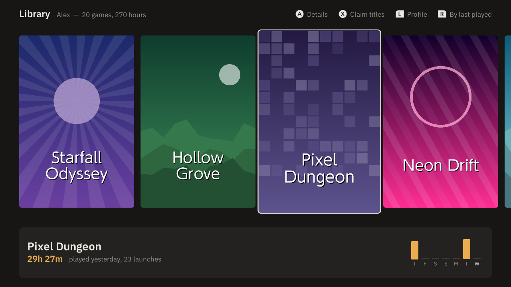
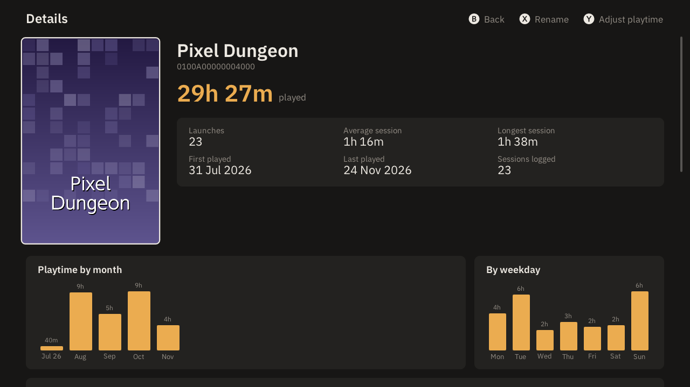
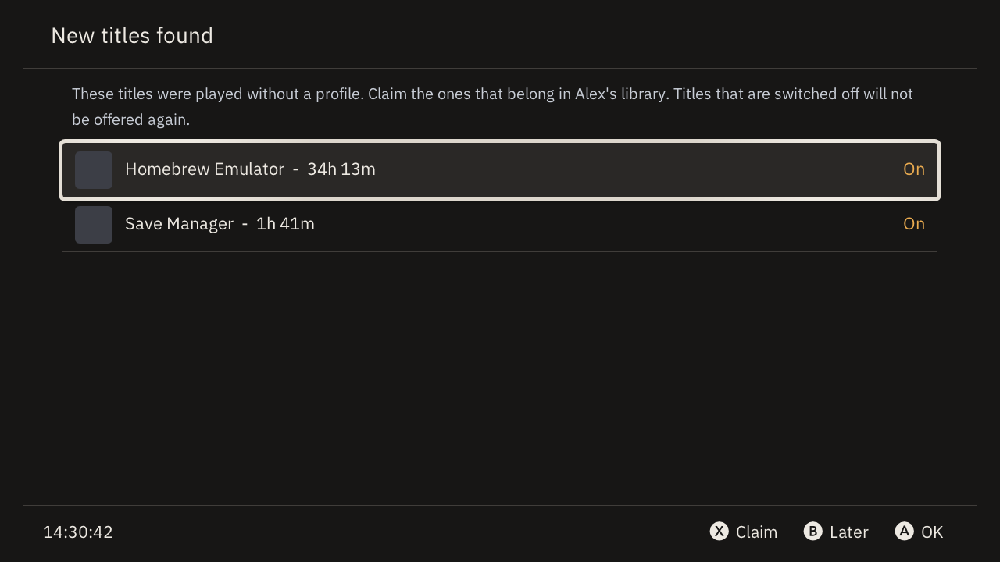

# Library

A playtime library for the Nintendo Switch. Your games as a shelf of boxart cards, with how long you played each one, when, and how often, per profile. Homebrew included.



| Details | New titles found |
| --- | --- |
|  |  |

*Screenshots: PC build with the demo data.*

## Features

- **Boxart shelf** per profile, sorted by playtime or by last played (R). The panel below shows the focused game's playtime, last played, launches and the last 7 days.
- **Details page** for every game: totals, average and longest session, first and last played, playtime per month and per weekday, and the last 50 sessions.
- **Homebrew and forwarders.** The system never links them to a profile, so other tools don't list them. Library notices them and lets a profile *claim* them. Claimed titles with the same name merge into one game, and their statistics are kept even after a forwarder is deleted.
- **Your history stays.** The app keeps its own copy of the console's play log, so deleted games and old sessions don't disappear. Names of deleted titles come from the system's cache.
- **Posters** from your own files, or downloaded automatically from [SteamGridDB](https://www.steamgriddb.com) (optional, needs a free API key). You can pick another poster per game.
- **Rename** a game, hide the homebrew badge, or **adjust the playtime** (for example after a save transfer). The recorded data stays untouched.
- **Export** everything to a text dump that can be opened on a PC.

## Installation

1. Get `Library.nro` (see [Building](#building)) and copy it to `sdmc:/switch/Library/`.
2. Start it from the Homebrew Menu in **title takeover** mode (hold R while launching a game), or make an NSP forwarder for it. It also works when started from the album (applet mode).

The app only reads the console's play data; it never changes it. Everything it stores lives in `sdmc:/config/Library/`.

### SteamGridDB posters (optional)

1. Create an account on [steamgriddb.com](https://www.steamgriddb.com) and generate an API key (Preferences → API).
2. Put the key on the first line of `sdmc:/config/Library/steamgriddb.txt`.

On the next start the app looks up a poster for every game without one, in the background. Press − on a card to choose a different poster or search under another name.

### Your own posters

Put an image named after the title ID (shown on the details page) into `sdmc:/config/Library/art/`, for example `art/0100F2C0115B6000.jpg`. JPEG or PNG, ideally 600x900. Your own files always win.

## Controls

| Button | Library | Details |
| --- | --- | --- |
| A | Open details | Change poster (on the poster) |
| B | | Back |
| X | Claim titles | Rename |
| Y | Export data | Adjust playtime |
| L | Choose a profile (with several profiles) | |
| R | Sort by playtime / last played | Show or hide the homebrew badge |
| − | Change poster | |

## Data files

All in `sdmc:/config/Library/`:

| File | Contents |
| --- | --- |
| `history.txt` | The app's copy of the play event log |
| `names.txt` | Names of every title seen |
| `claims.txt` | Claimed homebrew per profile, with saved statistics |
| `adjust.txt` | Playtime adjustments |
| `titles.txt` | Your own names and hidden homebrew badges |
| `profile.txt`, `sort.txt` | Last shown profile and sort order |
| `steamgriddb.txt` | Your SteamGridDB API key (optional) |
| `steamgriddb_lookups.txt` | What was looked up on SteamGridDB |
| `debug.log` | Start-up timings and messages |
| `dump.txt` | Written by the Y button |
| `art/`, `grids/`, `icons/`, `avatars/` | Your posters, downloaded posters, system icons, profile pictures |

`dump.txt` contains profile nicknames, game names and play times. Edit the nicknames before sharing it.

## Building

You need [devkitPro](https://devkitpro.org/wiki/Getting_Started) with the Switch packages (`switch-dev`, `switch-glm`, `switch-curl`).

```bash
cd app
git clone --depth 1 --recurse-submodules --shallow-submodules https://github.com/xfangfang/borealis extern/borealis
sh patch_borealis.sh
cmake -B build_switch -DPLATFORM_SWITCH=ON -DUSE_DEKO3D=ON -DCMAKE_DEPENDS_USE_COMPILER=OFF
cmake --build build_switch --target Library.nro
```

The app also builds and runs on a Linux PC with demo data, and the data code has unit tests. See [docs/DEVELOPMENT.md](docs/DEVELOPMENT.md) for both, and for how the code is organised.

## Credits

- [Borealis](https://github.com/xfangfang/borealis) (xfangfang's fork): the UI framework
- [libnx](https://github.com/switchbrew/libnx) and [devkitPro](https://devkitpro.org)
- [nanovg](https://github.com/memononen/nanovg), [stb](https://github.com/nothings/stb), [curl](https://curl.se)
- [IBM Plex Sans](https://github.com/IBM/plex) (SIL Open Font License)
- [SteamGridDB](https://www.steamgriddb.com) for the posters
- [NX Activity Log](https://github.com/tallbl0nde/NX-Activity-Log), the inspiration

Not affiliated with Nintendo or SteamGridDB.

## License

[MIT](LICENSE). Bundled third-party files keep their own licenses (listed in the LICENSE file).
